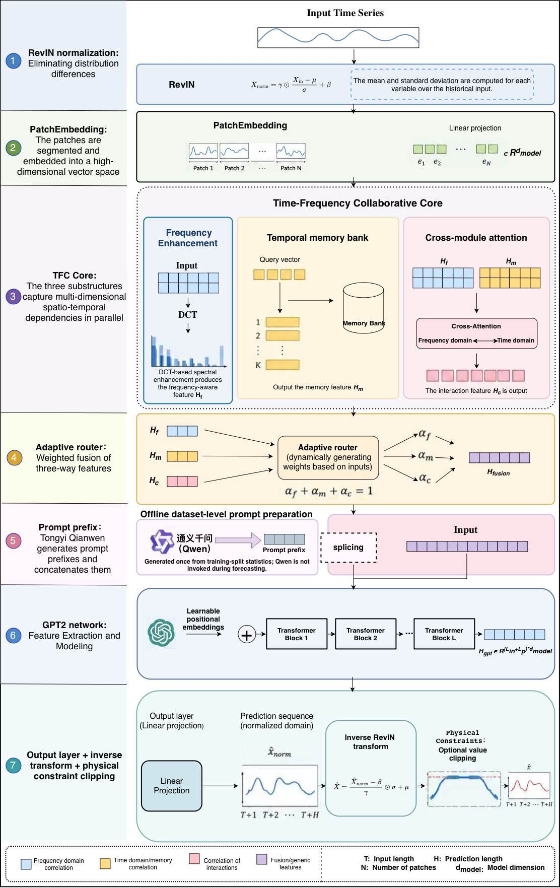

# TFCNet

**Time-Frequency Collaborative Network for LLM-Based Time Series Forecasting**

TFCNet brings recurring temporal patterns and frequency-domain structure together before a pretrained language-model backbone. Its **Time-Frequency Collaborative Core** combines Temporal Pattern Memory, Frequency Enhancement, Bidirectional Cross-Attention, and an Adaptive Router. Dataset-level prompt embeddings provide complementary statistical context.

**Haokun Xu and Junhai Zhai**  
Hebei Key Laboratory of Machine Learning and Computational Intelligence, College of Mathematics and Information Science, Hebei University

[Architecture](#architecture) · [Preparation](#preparation) · [Experiment configuration](#experiment-configuration) · [Release notes](#release-notes) · [Citation](#citation)

## Architecture

<p align="center">
  
</p>

1. **Input representation:** normalize historical observations and convert them into patch tokens.
2. **Frequency Enhancement:** process DCT-based spectral representations and fuse the reconstructed features with the input.
3. **Temporal Pattern Memory:** retrieve relevant temporal prototypes from a learnable memory bank.
4. **Time-frequency collaboration:** refine the two representations through bidirectional cross-attention and combine them using input-dependent routing.
5. **Forecasting:** incorporate dataset-level prompt embeddings and generate predictions through GPT-2 and the prediction head.

In the manuscript, Tongyi Qwen prepares summaries of training-set statistics offline, while GPT-2 serves as the forecasting backbone. The current code snapshot has implementation differences described in [release notes](#release-notes).

## Evaluation overview

| Item | Description |
| --- | --- |
| Task | Multivariate long-term time-series forecasting |
| Main datasets | ETTh1, ETTh2, ETTm1, ETTm2, Weather, Electricity (ECL), Traffic |
| Forecast horizons | 96, 192, 336, 720 |
| Training settings | Few-shot and full-shot |
| Additional manuscript evaluation | Exchange |
| Metrics | MSE and MAE; lower is better |

The current data loader supports the seven main datasets. Exchange support and the complete set of revision experiments are not included in this code snapshot.

## Repository layout

```text
TFCNet/
├── README.md
├── assets/
│   └── architecture.png
└── TFCNet/                         # Source directory
    ├── main.py                     # Experiment driver
    ├── TFCNet.py                   # Forecasting model
    ├── requirements.txt
    ├── data_provider/
    │   ├── data_factory.py
    │   └── data_loader.py
    ├── exp/
    │   ├── exp_basic.py
    │   ├── exp_supervised_finetuning.py
    │   └── exp_long_term_forecasting.py
    └── layers/
        ├── Embed.py
        ├── RevIN.py
        ├── TPECore.py              # Time-frequency collaboration modules
        └── einops_modules.py
```

## Preparation

### Environment

The original environment instructions specify Python 3.8. The pinned dependencies include PyTorch 1.13.1, Transformers 4.30.2, and PEFT 0.4.0.

```bash
git clone https://github.com/YouHanCheng6/TFCNet.git
cd TFCNet/TFCNet
python3.8 -m venv .venv
source .venv/bin/activate
pip install -r requirements.txt
```

The Qwen integration additionally imports `langchain`, `langchain-community`, and uses the DashScope SDK. Compatible versions are not pinned in this release. See [release notes](#release-notes) for the remaining prerequisites before running experiments.

### Datasets

The [dataset collection linked in the original implementation](https://drive.google.com/drive/folders/1vE0ONyqPlym2JaaAoEe0XNDR8FS_d322) provides the forecasting benchmarks. Arrange the CSV files relative to the directory containing `main.py`:

```text
dataset/
├── ETT-small/
│   ├── ETTh1.csv
│   ├── ETTh2.csv
│   ├── ETTm1.csv
│   └── ETTm2.csv
├── weather/
│   └── weather.csv
├── electricity/
│   └── electricity.csv
└── traffic/
    └── traffic.csv
```

Run experiments from `TFCNet/TFCNet/`: the driver sets `root_path` to the current working directory.

### Pretrained backbone and Qwen access

Download the [GPT-2 checkpoint](https://huggingface.co/openai-community/gpt2), including its configuration, weights, and tokenizer files, into `LLM/gpt2/` relative to `main.py`.

For the Qwen integration, set your own DashScope API key in the environment:

```bash
export DASHSCOPE_API_KEY="your-own-api-key"
```

Keep credentials out of source files and Git history. The GPT-2 dataset configuration sets `d_model` to **768**, overriding the parser's initial default of 512. The configuration dictionaries select the first six GPT-2 layers.

## Experiment configuration

The following examples describe the driver's configuration interface. Complete the missing source files and dependency setup listed in [release notes](#release-notes) before execution.

### Command-line configuration

```bash
python main.py \
  --data_name ETTh1 \
  --LLM gpt2 \
  --seq_len 336 \
  --patch_len 16 \
  --stride 8 \
  --pred_len_list 96 192 336 720 \
  --percent 100 \
  --ft_mode lp_ft
```

Supervised fine-tuning is enabled by default. Use `--percent 10` for the data loader's 10% training-data setting. Choose batch size and learning rates for the intended experiment; this example does not specify every manuscript hyperparameter.

### Configuration dictionaries

```bash
python main.py --overwrite_args
```

This option applies `fixed_params` and `tunable_params` from the `__main__` block, overwriting the corresponding command-line values. The committed example selects ETTh1, horizon 96, and 100% training data. Edit these dictionaries to configure other runs.

## Release notes

This release contains the model and experiment driver. The following items still need to be completed for a reproducible installation:

- **Source packaging:** the driver imports `utils.tools` and `utils.timefeatures`, but the `utils/` source directory is absent. It also imports `models.TFCNet`, whereas `TFCNet.py` is currently at the source-directory root. Restore the utilities and align the model import path.
- **Qwen dependencies:** the additional Qwen packages need a compatible, verified environment configuration.
- **Prompt preparation:** the current helper generates text during model setup and contains dataset-specific prompt settings. It needs to be synchronized with the revised manuscript's offline, cached dataset-level prompt preparation.
- **Ablation configurations:** some options retain legacy branches; verify the selected execution path against the intended manuscript experiment.

Benchmark datasets, pretrained TFCNet checkpoints, and complete reproduction logs are not bundled. End-to-end training has not been validated as part of this documentation update.

## Citation

If you use this work, please cite the manuscript:

> Haokun Xu and Junhai Zhai. **TFCNet: Time-Frequency Collaborative Network for LLM-Based Time Series Forecasting.**

## Acknowledgements

This implementation builds on **LLM4TS**:

> Ching Chang, Wen-Chih Peng, and Tien-Fu Chen. *LLM4TS: Two-Stage Fine-Tuning for Time-Series Forecasting with Pre-Trained LLMs*. [arXiv:2308.08469](https://arxiv.org/abs/2308.08469).

We also acknowledge the [Time Series Library](https://github.com/thuml/Time-Series-Library) and the open-source libraries used by this implementation.

## Questions

Please open a [GitHub issue](https://github.com/YouHanCheng6/TFCNet/issues) with the dataset, forecasting horizon, configuration, and relevant error traceback.

## License

No project license is currently included in this repository. Third-party code and model checkpoints remain subject to their respective licenses.
